<picture>
  <source media="(prefers-color-scheme: dark)" srcset="docs/hero-dark.svg">
  
</picture>

# Optiman

写真フォルダに追加された写真を、画質を一切変えずに JPEG XL へ変換する macOS / Windows 用ツールです。JPEG は元のファイルにいつでも戻せる形のまま約 2 割、PNG は約 3〜4 割小さくなります。待っている間は CPU を使いません。

ダウンロードと手順は [配布ページ](https://tsubasatommy.github.io/optiman/) に、過去の版は [リリース](https://github.com/TsubasaTommy/optiman/releases) にあります。

## インストール

### macOS 11 以降 (Homebrew)

```sh
brew install tsubasatommy/tap/optiman
optiman install
```

`install` で、変換するフォルダ (既定は `~/Pictures`。写真ライブラリの中身は対象外)、元ファイルの扱い、既存の写真も変換するかを聞かれます。設定画面は `optiman settings` か `~/Applications/Optiman.app` で開けます。

Homebrew を使わない場合は、次を実行します。最新リリースをダウンロードし、SHA256 を確かめてから `~/.local/bin` に置きます。

```sh
curl -fsSL https://tsubasatommy.github.io/optiman/install.sh | sh
```

### Windows 10 / 11

[Optiman-Setup.exe をダウンロード](https://github.com/TsubasaTommy/optiman/releases/latest/download/Optiman-Setup.exe)

x64 と ARM64 の両方に対応したユーザー単位のインストーラーで、管理者権限は要りません。インストール中に、元ファイルの扱いと既存の写真も変換するかを選びます。設定画面はスタートメニューの「Optiman」から開けます。コマンド (`status`、`restore` など) は PATH に追加されます。

> [!NOTE]
> インストーラーにはコード署名をしていません (証明書が有料のため)。ブラウザでダウンロードすると SmartScreen の警告が出ることがあります。その場合は [SHA256SUMS.txt](https://github.com/TsubasaTommy/optiman/releases/latest/download/SHA256SUMS.txt) でハッシュを確かめてから、「詳細情報」を押して「実行」を選んでください。下の PowerShell や winget で入れると警告は出ません。

PowerShell から入れる場合は、次を実行します。最新の Setup.exe をダウンロードし、SHA256 を確かめてから起動します。

```powershell
irm https://tsubasatommy.github.io/optiman/install.ps1 | iex
```

winget でも入れられます。登録は Microsoft の審査中です ([winget-pkgs #486317](https://github.com/microsoft/winget-pkgs/pull/486317))。見つからない場合は、上のインストーラーか PowerShell で入れてください。

```powershell
winget install TsubasaTommy.Optiman
```

## JPEG XL を表示するには

| OS | 表示のしかた |
|---|---|
| macOS 14 以降 | そのまま表示できます (Finder、プレビュー、写真)。 |
| Windows 11 24H2 以降 | Microsoft 公式の無料拡張「[JPEG XL Image Extension](https://apps.microsoft.com/detail/9MZPRTH5C0TB)」を入れると、エクスプローラーやフォトで表示できます。**インストーラーがこの拡張も一緒に入れます** (チェックを外せば入れません。winget で入れた場合は入らないので、下の方法で入れてください)。 |
| それ以前の OS | 変換はされますが、標準のアプリでは表示できません。`restore` でいつでも元に戻せます。 |

拡張をあとから入れる場合は、設定画面の「拡張機能をインストール」を押すか、次を実行します。

```powershell
winget install --id 9MZPRTH5C0TB --source msstore
```

## 変換の仕様

| 元の形式 | 変換のしかた | 元ファイルを消す前の確認 |
|---|---|---|
| JPEG | libjxl による JPEG のロスレス再圧縮。EXIF、XMP、ICC などのマーカーもすべて保持 | JPEG XL から復元した JPEG が、元ファイルと**バイト単位で一致**すること。さらに jxl-rs で全体をデコードできること |
| PNG、TIFF、BMP、ロスレス WebP | OS でデコードした値をそのまま、完全ロスレス (modular lossless) でエンコード。ICC (sRGB と Display P3 は CICP)、8 / 16 bit、透過、グレースケール、向き (Orientation)、EXIF / XMP を保持 | jxl-rs でデコードした画素が、元と**完全に一致**すること |
| HEIC / HEIF、非可逆 WebP、RAW、CMYK、浮動小数点 (HDR)、ゲインマップ付き JPEG、HDR の PNG、アニメーション | 変換しません。劣化なしでは変換できないため、元のまま残します | |

- 「圧縮の強さ」(1〜9、既定 7) で変わるのはサイズと時間だけで、画質は常に元と同じです。
- 変換しても小さくならないファイルは、元のまま残します。

> [!WARNING]
> **元の写真は、既定では削除されます。** 上の確認に成功し、変換中に元ファイルが変わっていないことを確かめてから削除します。心配な場合は、インストール時に「ゴミ箱へ移動」か「残す」を選んでください。削除したあとでも `optiman restore <ファイルまたはフォルダ>` で元に戻せます (JPEG はバイト単位で元どおり、それ以外は同じ画素の PNG)。

4K 写真での実測値 (Apple Silicon、低優先度で実行):

| 元のファイル | JPEG XL | 時間 |
|---|---|---|
| JPEG 2.29 MB | 1.85 MB (−19%) | 1.9 秒 |
| PNG 10.3 MB、圧縮の強さ 3 | 6.87 MB (−33%) | 6.6 秒 |
| PNG 10.3 MB、圧縮の強さ 7 (既定) | 5.76 MB (−44%) | 28 秒 |

## 待っている間と変換中

| 待機中の実測値 | CPU 時間 | スレッド | 専有メモリ |
|---|---|---|---|
| macOS | プロセス自体がありません | | |
| Windows x64 | 30 秒間で 0 ms | 1 本 | 2.3 MB |
| Windows ARM64 | 30 秒間で 0 ms | 2 本 | 2.8 MB |

CI では、macOS と Windows の両方で、待機中に CPU 時間が増えないことを確かめています (`scripts/idle-check.sh`、`scripts/idle-check.ps1`)。

| | macOS | Windows |
|---|---|---|
| 起動 | launchd の `LaunchEvents` (`com.apple.fsevents.matching`)。監視フォルダの中で何かが変わったときだけ launchd がプロセスを起動し、処理が終わって 5 秒たつと終了します。**待機中はプロセスがありません** | ログイン時に起動します (HKCU の Run)。メインスレッドが 1 つの I/O 完了ポートで待ちます |
| 変更の検出 | FSEvents。前回の event id から履歴を再生するので、止まっていた間の変更も取りこぼしません。除外フォルダと写真ライブラリは `FSEventStreamSetExclusionPaths` で通知自体を止めます | `ReadDirectoryChangesW` (サブツリー、overlapped)。停止要求 (名前付きパイプ) と変換結果の通知も、同じ完了ポートで受けます。**待機中のスレッドは 1 本**で、`GetQueuedCompletionStatus(INFINITE)` で眠っています |
| 変換 | 必要なときだけ子プロセス (`worker`) を起動します。`PRIO_DARWIN_BG` と Background QoS で、効率コアで動き I/O も抑えます | 必要なときだけ子プロセスを起動します。`PROCESS_MODE_BACKGROUND_BEGIN` と EcoQoS を使います |
| 待機中のメモリ | 0 (プロセスがありません) | 常駐プロセスは EcoQoS と最低のメモリ優先度で動き、待機に入るとワーキングセットを OS に返します |
| 設定画面 | 開いている間だけ動く別プロセス (AppKit)。閉じれば終了します | 開いている間だけ動く別プロセス (Win32)。閉じれば終了します |

### 1 枚を変換する手順

1. 隠しファイル、写真ライブラリ (`*.photoslibrary` など) の中身、クラウドにしかないファイル (iCloud の未ダウンロード、OneDrive のオンデマンド)、除外フォルダは対象外にします。
2. 書き込みが終わったファイルだけを扱います。サイズと更新日時が `settle_seconds` の間変わらないこと、Windows では書き込み中のプロセスがないことを確かめます。
3. 失われる情報があるファイル (上の「変換しません」の形式) は、元のまま残してスキップ一覧に記録します。
4. メモリ上で JPEG XL にエンコードし、上の表の方法で確認します。
5. 隠し一時ファイルに書き出して `fsync` し、`rename` で置きます。更新日時、作成日時、Finder タグは元ファイルから引き継ぎます。
6. 元ファイルがエンコード中に変わっていないことを確かめてから、設定に従って削除、ゴミ箱へ移動、残す、のいずれかを行います。

スキップしたファイルは、内容が変わるまで再挑戦しません。

### 使っているもの

- エンコード: [libjxl](https://github.com/libjxl/libjxl) 0.13 (JPEG XL の公式リファレンス実装、BSD-3-Clause)。git submodule から静的にリンクしています。
- 確認用のデコード: [jxl-rs](https://github.com/libjxl/jxl-rs) (BSD-3-Clause)
- 画像の読み込み: ImageIO (macOS)、WIC (Windows)。色変換も回転もせず、保存されている値をそのまま取り出します。

## 使い方

| コマンド | 内容 |
|---|---|
| `install` | 設定を作り、自動起動に登録します (`--folder` `--exclude` `--new-only` `--scan-existing` `--original delete\|trash\|keep` `--effort 1-9` `--yes`) |
| `settings` | 設定画面を開きます (圧縮の強さ、変換するフォルダ、除外するフォルダ) |
| `status` | 状態、設定、監視フォルダにアクセスできるか、最近のログを表示します |
| `convert <パス>...` | ファイルやフォルダを今すぐ変換します (`--dry-run` で確認だけ。ほかに `--original` `--effort` `-j`) |
| `restore <パス>...` | JPEG XL から元のファイルを復元します (`--delete-jxl` で、復元できた .jxl を削除) |
| `start` `stop` `restart` | 監視を開始、停止、再起動します (設定ファイルを手で編集したとき) |
| `config` | 設定ファイルの場所と内容を表示します |
| `uninstall [--purge]` | 自動起動を解除します。`--purge` で設定、状態、ログも消します |

### 設定ファイル

設定画面で変えられますが、手で編集することもできます (編集したら `restart`)。

- macOS: `~/Library/Application Support/optiman/config.toml`
- Windows: `%APPDATA%\optiman\config.toml`

```toml
folders = ["~/Pictures"]   # 変換するフォルダ (サブフォルダも対象)
exclude_folders = []       # 変換しないフォルダ
effort = 7                 # 圧縮の強さ 1 (速い) - 9 (小さい)。画質は常に劣化なし
original = "delete"        # delete | trash | keep
scan_existing = false      # 起動時に既存の写真も変換するか
jobs = 0                   # 同時変換数 (0 = 自動)
settle_seconds = 2         # 書き込みが止まってから変換するまでの秒数
skip_if_larger = true      # JPEG XL の方が大きくなる場合は元ファイルを残す
extensions = ["jpg", "jpeg", "png", "bmp", "tif", "tiff", "webp"]
exclude = []               # 除外するフォルダ/ファイル名のパターン (* と ?)
```

ログは、macOS では `~/Library/Logs/optiman/`、Windows では `%LOCALAPPDATA%\optiman\logs\` にあります。

## アンインストール

macOS:

```sh
optiman uninstall --purge
brew uninstall optiman
```

Windows では、「設定」の「アプリ」から「Optiman」をアンインストールするか、次を実行します。

```powershell
winget uninstall TsubasaTommy.Optiman
```

変換済みの JPEG XL はそのまま残ります。元に戻したい場合は、アンインストールの前に `restore` を実行してください。

## 既知の制約

- 「新規のみ」モードでは、ほかの場所からフォルダごと**移動**してきた写真は対象になりません (コピーなら対象)。必要なら `convert <フォルダ>` を実行してください。
- 監視中のフォルダで `restore` すると、復元したファイルはスキップ一覧に記録されるので、再び変換されることはありません。
- 署名なし (ad-hoc 署名) のビルドでは、更新のたびに macOS がフォルダへのアクセス許可を求め直すことがあります。`status` で監視フォルダにアクセスできるか確かめられます。

## ソースからビルド

Rust 1.100 (`rust-toolchain.toml` で固定) と CMake が必要です。

```sh
scripts/fetch-libjxl.sh     # libjxl と必要なサブモジュールだけを浅く取得
cargo build --release
cargo test
scripts/idle-check.sh target/release/optiman 60
```

リリースは、`v*` タグを push すると GitHub Actions が作ります (macOS Universal の tar.gz、Windows の Setup.exe と x64 / ARM64 の zip)。Homebrew の Formula と winget のマニフェストは `scripts/render_packaging.py` で生成します。

冒頭の画像は `docs/hero-light.svg` と `docs/hero-dark.svg` です。色と文字は [配布ページ](site/index.html) の冒頭と揃えています。

## ライセンス

MIT。同梱しているライブラリのライセンスは `THIRD_PARTY_LICENSES.txt` にあります。
